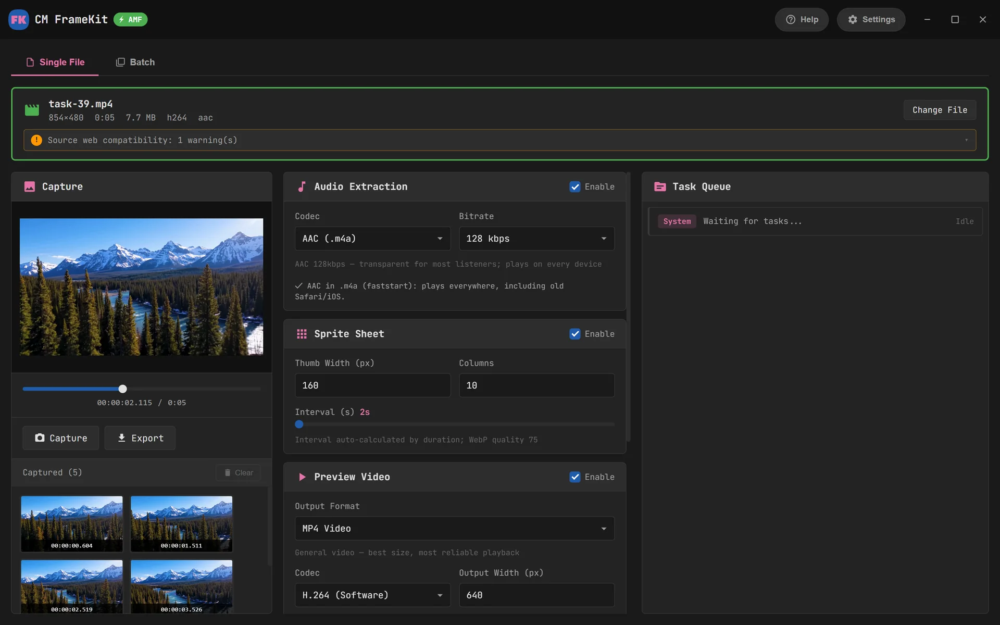
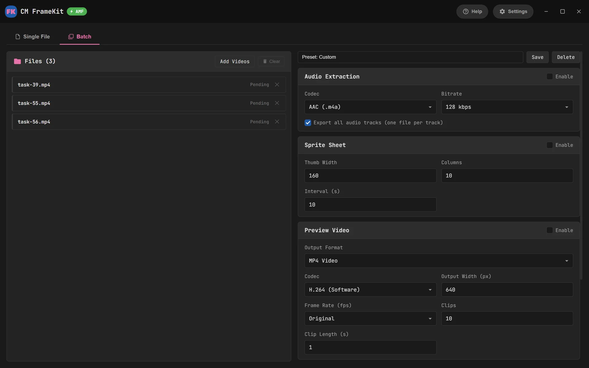
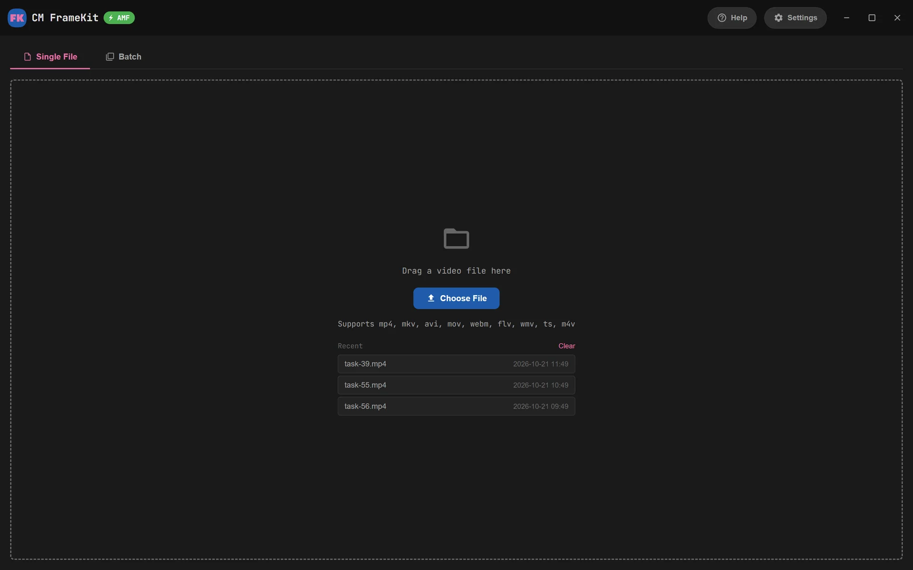

<p align="center">
  
</p>

<h1 align="center">CM FrameKit</h1>

<p align="center">
  Frames · Audio · Sprites · Preview videos<br>
  Output that plays in <b>every browser and on every Apple device</b>
</p>

<p align="center">
  <a href="https://fk.complexmission.com/?lang=en"></a>
  <a href="https://fk.complexmission.com/download?lang=en"></a>
  <a href="LICENSE"></a>
</p>

<p align="center"><a href="README.md">中文</a> · <b>English</b></p>



CM FrameKit is a free, open-source video tool for Windows. It captures frames, extracts audio, builds sprite sheets with WebVTT and exports preview videos, and everything it writes plays straight from a web page in every browser and on every Apple device. It is a Rust + Tauri rewrite of the Electron-based "CM Video Toolkit", ships with a slim, purpose-built FFmpeg, and the installer is about 19 MB.

**[Download the latest version](https://fk.complexmission.com/download?lang=en)** · [Changelog](https://fk.complexmission.com/changelog?lang=en) · [Contact](https://fk.complexmission.com/contact?lang=en)

## Features

- **Frame capture**: step through the timeline frame by frame, or batch-export at an interval as PNG / JPG / WebP
- **Audio extraction**: AAC (.m4a) / MP3 / Opus, with each audio track exported separately
- **Sprites + WebVTT**: thumbnail sprites for player scrubbing, split automatically past the WebP size limit
- **Preview videos**: join clips into MP4 (H.264 / H.265), GIF or animated WebP
- **Hardware encoding**: NVIDIA NVENC, Intel QSV, AMD AMF; software encoding stays the default for better quality
- **Batch mode**: add many videos and export them all with the same settings, and save your favourite settings as presets
- **Chinese / English interface**, with an update check at startup

## Web compatibility

- Flags web playback risks in every imported file: moov position, hev1, 10-bit H.264, AV1 (no hardware decoding on M1), AC-3 / Opus audio, HDR and more
- MP4 output is always 8-bit 4:2:0 + AAC + faststart + hvc1, and is verified after writing
- HDR → SDR tone mapping, automatic deinterlacing, non-square pixel correction and portrait rotation
- Formats the WebView can't play (AVI / WMV / MPEG-2 / ProRes …) fall back to FFmpeg frame-by-frame preview; capture and export still work

The background on each issue and how it is handled is in [docs/COMPATIBILITY.md](docs/COMPATIBILITY.md) (in Chinese).

## Privacy

Everything runs locally; your video files never leave your computer. The only network request the app makes is a version check at startup to `https://fk.complexmission.com/api/update`, which sends just the current version, platform and UI language (see [`ui/update.js`](ui/update.js)).

<table>
  <tr>
    <td></td>
    <td></td>
  </tr>
  <tr>
    <td align="center">Batch mode</td>
    <td align="center">Start screen</td>
  </tr>
</table>

## Development

You need Node.js, the Rust toolchain, and Git Bash + WinLibs MinGW (or MSYS2 MINGW64) to build FFmpeg.

```bash
npm install
npm run ffmpeg      # build the slim FFmpeg → src-tauri/ffmpeg/ (about 20–30 min the first time, then only FFmpeg itself is rebuilt)
npm run dev         # run
npm run build       # build the NSIS installer → src-tauri/target/release/bundle/nsis/
```

Before a release, bump the version in all three of `package.json`, `src-tauri/Cargo.toml` and `src-tauri/tauri.conf.json`.

### Slim FFmpeg

`scripts/build-ffmpeg.sh` builds it from source:

- `--disable-everything`, then only the components that are used
  - Input is as broad as possible: mainstream containers and codecs, AV1 through dav1d
  - Output is only the formats this app writes
- Encoders: x264, x265 (8-bit), libwebp, LAME, Opus, zimg (HDR tone mapping)
- Hardware encoding: NVENC, AMF, QSV (libvpl)
- Shared build: `ffmpeg.exe` / `ffprobe.exe` share one set of DLLs, with no MinGW runtime dependency
- No network protocols and no avdevice

### Self-test

```bash
cd src-tauri
FRAMEKIT_TEST_MEDIA=<media folder> cargo test --test selftest -- --ignored --nocapture
```

Runs every task on every file in the folder and checks the output with ffprobe and the built-in MP4 scanner (pixel format, audio codec, faststart, hvc1, sprite splitting).

## Layout

| Path | Contents |
| --- | --- |
| `ui/` | Interface (HTML / CSS / JS); Chinese and English strings live in `i18n.js` |
| `src-tauri/` | Rust backend: FFmpeg calls, probing, frame capture, sprites, MP4 verification |
| `scripts/` | Build scripts for the slim FFmpeg |
| `website/` | Go backend for [fk.complexmission.com](https://fk.complexmission.com/?lang=en): site, changelog, installer downloads, release admin. See [website/README.md](website/README.md) (in Chinese) |
| `docs/` | Compatibility notes |

## License

The code in this repository is released under the [MIT](LICENSE) license.

The bundled FFmpeg, x264 and x265 are GPL and ship as separate executables; their license is in `ffmpeg/LICENSE-FFmpeg-GPLv2.txt` in the install folder.
