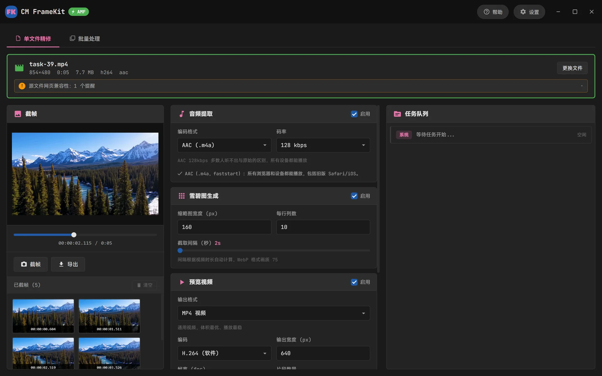
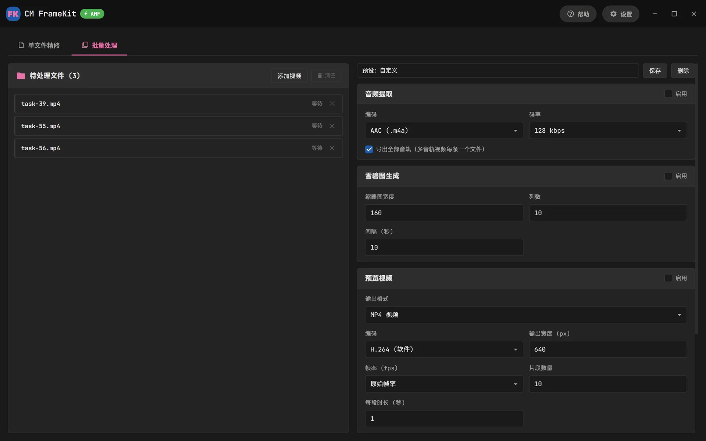
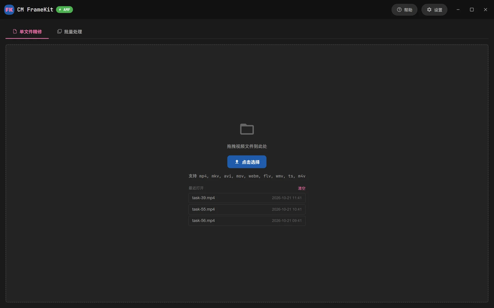

<p align="center">
  
</p>

<h1 align="center">CM FrameKit</h1>

<p align="center">
  截帧 · 提取音频 · 雪碧图 · 预览视频<br>
  输出面向<b>全浏览器 / 全 Apple 设备兼容</b>
</p>

<p align="center">
  <a href="https://fk.complexmission.com"></a>
  <a href="https://fk.complexmission.com/download"></a>
  <a href="LICENSE"></a>
</p>

<p align="center"><b>中文</b> · <a href="README.en.md">English</a></p>



CM FrameKit 是一款免费开源的 Windows 视频工具：从视频里截帧、提取音频、生成雪碧图与 WebVTT、导出预览视频，导出的文件直接放进网页就能在所有浏览器和 Apple 设备上播放。它是「CM视频工具箱」（Electron）的 Rust + Tauri 重写版，内置精简编译的 FFmpeg，安装包约 19 MB。

**[下载最新版](https://fk.complexmission.com/download)** · [更新日志](https://fk.complexmission.com/changelog) · [留言反馈](https://fk.complexmission.com/contact)

## 功能

- **截帧**：时间轴逐帧定位截图，也可按间隔批量导出 PNG / JPG / WebP
- **提取音频**：AAC (.m4a) / MP3 / Opus，多音轨视频每条音轨单独导出
- **雪碧图 + WebVTT**：生成播放器拖动预览缩略图，超过 WebP 尺寸上限自动分成多张
- **预览视频**：多片段拼接，输出 MP4（H.264 / H.265）/ GIF / 动画 WebP
- **硬件加速编码**：NVIDIA NVENC、Intel QSV、AMD AMF；默认使用画质更好的软件编码
- **批量处理**：一次加入多个视频，按同一套设置统一导出，常用设置可保存为预设
- **中文 / English 界面**，启动时自动检查新版本

## 网页兼容性

- 导入时分析源文件的网页播放风险：moov 位置、hev1、10-bit H.264、AV1（M1 不支持硬解）、AC-3 / Opus 音频、HDR 等
- 生成的 MP4 固定为 8-bit 4:2:0 + AAC + faststart + hvc1，写完会自动校验
- HDR → SDR 色调映射、自动反交错、非方形像素校正、竖拍旋转
- WebView 放不了的格式（AVI / WMV / MPEG-2 / ProRes …）自动切换为 FFmpeg 逐帧预览，截帧和导出不受影响

各种问题的来龙去脉和对应处理见 [docs/COMPATIBILITY.md](docs/COMPATIBILITY.md)。

## 隐私

所有处理都在本机完成，视频文件不会离开你的电脑。软件唯一的联网请求是启动时向 `https://fk.complexmission.com/api/update` 查询新版本，只带当前版本号、平台和界面语言（见 [`ui/update.js`](ui/update.js)）。

<table>
  <tr>
    <td></td>
    <td></td>
  </tr>
  <tr>
    <td align="center">批量处理</td>
    <td align="center">开始页</td>
  </tr>
</table>

## 开发

需要 Node.js、Rust 工具链，以及编译 FFmpeg 用的 Git Bash + WinLibs MinGW（或 MSYS2 MINGW64）。

```bash
npm install
npm run ffmpeg      # 编译精简 FFmpeg → src-tauri/ffmpeg/（首次约 20–30 分钟，之后只重编 FFmpeg）
npm run dev         # 启动
npm run build       # 打包 NSIS 安装包 → src-tauri/target/release/bundle/nsis/
```

发布新版本前，把 `package.json`、`src-tauri/Cargo.toml`、`src-tauri/tauri.conf.json` 三处的版本号一起改掉。

### 精简 FFmpeg

`scripts/build-ffmpeg.sh` 从源码编译：

- `--disable-everything` 后只开启用到的组件
  - 输入面尽量宽：主流容器与编解码器，AV1 用 dav1d
  - 输出只有本软件会写的格式
- 编码库：x264、x265（8-bit）、libwebp、LAME、Opus、zimg（HDR 色调映射）
- 硬件编码：NVENC、AMF、QSV（libvpl）
- shared 构建：`ffmpeg.exe` / `ffprobe.exe` 共用一套 DLL，无 MinGW 运行时依赖
- 不含网络协议和 avdevice

### 自测

```bash
cd src-tauri
FRAMEKIT_TEST_MEDIA=<素材目录> cargo test --test selftest -- --ignored --nocapture
```

对目录里每个文件跑全部任务，并用 ffprobe 与内置 MP4 扫描器校验输出（像素格式、音频编码、faststart、hvc1、雪碧图分张）。

## 目录

| 路径 | 内容 |
| --- | --- |
| `ui/` | 界面（HTML / CSS / JS），中英文文案在 `i18n.js` |
| `src-tauri/` | Rust 后端：FFmpeg 调用、探测、截帧、雪碧图、MP4 校验 |
| `scripts/` | 精简 FFmpeg 的编译脚本 |
| `website/` | [fk.complexmission.com](https://fk.complexmission.com) 的 Go 后端：官网、更新日志、安装包下载、发布后台，见 [website/README.md](website/README.md) |
| `docs/` | 兼容性评估 |

## 许可证

本项目代码以 [MIT](LICENSE) 许可证开源。

随软件分发的 FFmpeg 及 x264 / x265 为 GPL，以独立可执行文件的形式提供，许可证见安装目录下的 `ffmpeg/LICENSE-FFmpeg-GPLv2.txt`。
